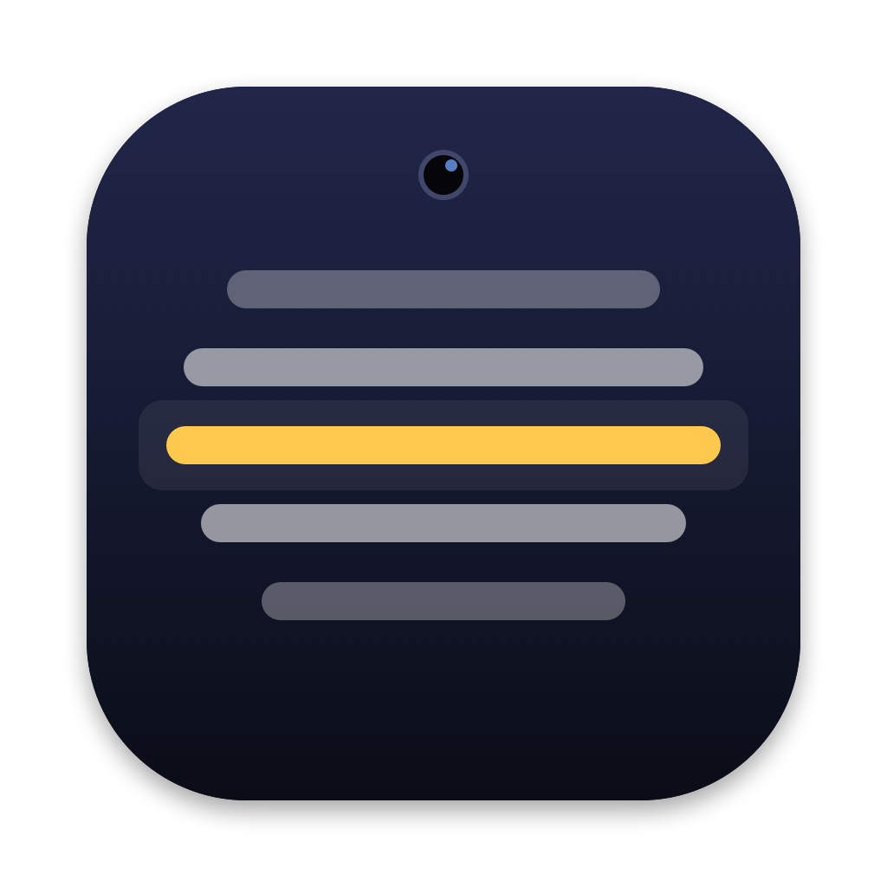

<p align="center">
  
</p>

<h1 align="center">Prompter</h1>

<p align="center">
  Kameranın hemen altında duran, macOS için sade ve hafif bir teleprompter.
</p>

<p align="center">
  <a href="README.md">English</a> · <b>Türkçe</b>
</p>

---

Kamerayla kayıt alırken metni okumak için yapıldı. Pencere ekranın üst ortasında, kameranın hemen altında açılır ve diğer pencerelerin üstünde kalır. Gözünüz kameradan fazla uzaklaşmadan metni okursunuz. Tek bir Swift/AppKit uygulamasıdır. Xcode projesi ya da başka bir bağımlılık gerektirmez.

## Özellikler

- **Her zaman üstte**: Kameranın altında, bütün masaüstlerinde ve tam ekran uygulamaların üstünde görünür.
- **Akıcı kaydırma**: Hız ayarlanabilir. Fare tekerleğiyle elle kaydırınca kaydırma bıraktığınız yerden devam eder.
- **Ayar çubuğu**: Fareyi pencerenin üzerine getirince altta açılır. Buradan şunlar ayarlanır:
  - arka plan rengi ve saydamlığı,
  - yazı rengi ve boyutu,
  - kaydırma hızı,
  - başlat/durdur ve dosya aç düğmeleri.
- **Yerinde düzenleme**: Metne tıklayınca imleç tıkladığınız yere gelir, doğrudan yazarsınız. Esc düzenlemeyi bitirir.
- **Metin yükleme**: `⌘V` ile panodan yapıştırabilir ya da `⌘O` ile `.txt`/`.md` dosyası açabilirsiniz.
- **Ayarlar kalıcı**: Metin, renkler, yazı boyutu, hız ve pencerenin yeri uygulamayı kapatıp açınca aynı kalır.

## Kurulum

Gereksinimler: **macOS 13 veya üstü** ve Xcode Command Line Tools.

```bash
xcode-select --install          # Command Line Tools yüklü değilse

git clone https://github.com/serbestonline/Prompter.git
cd Prompter
./build.sh --install            # derler ve ~/Applications altına kurar
open ~/Applications/Prompter.app
```

Sadece `./build.sh` çalıştırırsanız uygulama `build/Prompter.app` olarak derlenir, bir yere kurulmaz.

> Uygulama yerelde, Apple'a kayıtlı bir geliştirici imzası olmadan imzalanır. Derlenmiş `.app` dosyasını başka bir Mac'e taşırsanız ilk açılışta **sağ tık → Aç** demeniz gerekir.

## Kullanım

| Tuş | İşlev |
|---|---|
| `Space` | Başlat / durdur |
| `↑` `↓` | Hızı artır / azalt |
| `+` `−` | Yazıyı büyüt / küçült (Türkçe klavyede `*` da büyütür) |
| `←` `→` | Birkaç satır geri / ileri |
| `R` | Başa dön |
| `Esc` | Durdur / düzenlemeyi bitir |
| `⌘V` | Panodaki metni yükle (mevcut metnin yerine geçer) |
| `⌘O` | Metin dosyası aç |
| `⌘Q` | Çık |

Pencereyi üst kenarından tutup taşıyabilir, kenarlarından çekip boyutunu değiştirebilirsiniz.

Tüm ayarları sıfırlamak için:

```bash
defaults delete com.serbest.prompter
```

## Proje yapısı

```text
Sources/
├── main.swift          # uygulama, pencere, kaydırma, klavye ve düzenleme
├── ControlBar.swift    # fareyle açılan ayar çubuğu ve HoverView
├── MainMenu.swift      # düzenleme kısayolları için Düzen menüsü
└── ColorStore.swift    # renkleri UserDefaults'a yazar / okur
scripts/
└── make_icon.swift     # uygulama simgesini çizer (1024×1024 PNG)
assets/
└── icon.png
build.sh                # derleme, simge üretme, imzalama, kurma
```

## Bilinen sorunlar

- Renk paneli açıkken uygulama kapatılırsa, macOS paneli bir sonraki açılışta geri getirir. Panel açık olduğu sürece ayar çubuğu gizlenmez. Paneli kapatınca düzelir.

## Lisans

[MIT](LICENSE)
